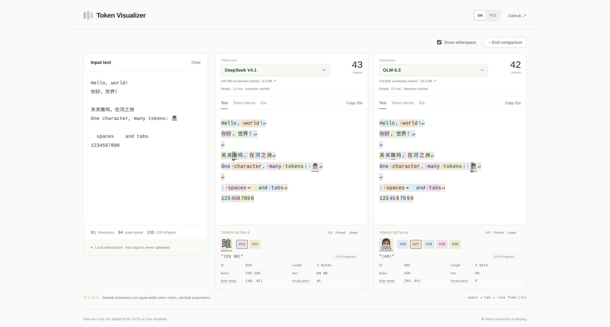

# Token Visualizer

A lightweight playground for exploring how LLMs split text into tokens.

[Open the app](https://propathee.github.io/token-visualizer/)

## Features

- Color-coded tokens, with intact characters and emoji.
- **Text**, **Token pieces**, and **IDs** views.
- Side-by-side model comparison.
- Hover or pin tokens to inspect their IDs, UTF-8 bytes, and hex.
- Whitespace visualization and token, character, and byte counts.
- English and Chinese interface.

Tokenization runs locally in your browser. Your input is never uploaded. Tokenizers download on demand and are cached for reuse.

## Supported models

- DeepSeek V4
- DeepSeek V4.1
- GLM-5.3
- Qwen3.8-2.4T-A95B

[Developer documentation](docs/development.md)

## Acknowledgments

- [dqbd/tiktokenizer](https://github.com/dqbd/tiktokenizer)
- [ilyfairy/tiktokenizer](https://github.com/ilyfairy/tiktokenizer)
- [mohitpandeycs/Token-Visualizer](https://github.com/mohitpandeycs/Token-Visualizer)
